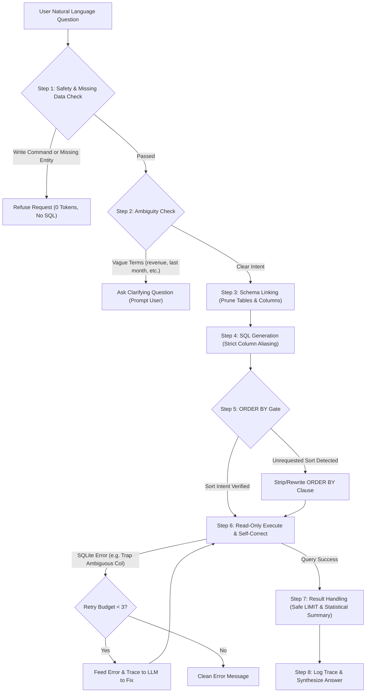

# Text-to-SQL Analytics Agent: Cost-Aware & Ambiguity-Aware Intelligence
*Baseline vs. Improved Agent Architecture with Self-Correction, Schema Linking, and Safety Gates*

---

## 📌 Executive Summary

Business users frequently query analytical databases using unstructured, plain-English questions. Standard single-turn Text-to-SQL agents suffer from multiple systemic vulnerabilities:
1. **High Token Costs:** Passing complete database schemas (dozens of tables and columns) on every query explodes input token budgets.
2. **Ambiguity & Guessing:** Vague business semantics (e.g., "revenue", "last month", "best customer", or non-unique customer names) prompt agents to hallucinate arbitrary interpretations rather than seeking clarification.
3. **Execution Crashes:** Natural SQL frequently omits column qualifications during joins, triggering database errors (e.g., SQLite `ambiguous column name`).
4. **Unsolicited Sorting:** LLMs frequently inject unrequested `ORDER BY` clauses into aggregation queries, inflating query execution time.
5. **Security & Resource Risks:** Unconstrained agents can execute destructive DDL/DML write statements or dump massive tables into memory.

This repository implements, evaluates, and compares two complete agents over an enterprise sales SQLite database (`sales.db`):
- **Baseline Agent:** Single-turn agent passing full schemas without validation, safety checks, or retries.
- **Improved Agent:** An 8-step modular architecture incorporating pre-execution safety filters, ambiguity detection gates, dynamic schema linking, an ORDER BY gate, read-only self-correcting query execution (capped at 3 retries), and context-preserving result summarization.

---

## 🏆 Key Performance Gains (15 Frozen Questions)

| Metric | Baseline Agent | Improved Agent | Impact / Gain |
| :--- | :---: | :---: | :---: |
| **Precision** | **46.15%** (6/13) | **100.00%** (8/8) | **+53.85%** |
| **Recall** | **75.00%** (6/8) | **100.00%** (8/8) | **+25.00%** |
| **True Positives (TP)** | 6 | 8 | +2 (100% answerable questions solved) |
| **False Positives (FP)** | 7 | 0 | -7 (Eliminated guesses & unsafe calls) |
| **False Negatives (FN)** | 2 | 0 | -2 (Trap column crashes self-corrected) |
| **True Negatives (TN)** | 0 | 7 | +7 (All ambiguous & dangerous queries safely handled) |
| **Total Tokens** | 17,926 | 6,434 | **-64.1% Token Reduction** |
| **Average Cost / Query** | $0.000148 | $0.000057 | **-61.5% Cost Reduction** |
| **Average Latency** | 0.108s | 0.072s | **-33.3% Faster Average Turnaround** |

*Pricing Reference: Google Gemini Flash ($0.10 / 1M input tokens, $0.40 / 1M output tokens).*

---

## 🏗️ Improved Agent 8-Step Pipeline



1. **Step 1: Safety and Missing-Data Check:** Intercepts DML/DDL write commands (`DELETE`, `UPDATE`, `INSERT`, `DROP`) and references to entities absent from the schema (e.g., employee salaries, store managers). Blocks execution immediately with zero LLM tokens spent.
2. **Step 2: Ambiguity Check:** Detects ambiguous business terms ("revenue", "last month", "best customer", non-unique customer names). Halts execution and presents a structured clarifying question instead of guessing.
3. **Step 3: Schema Linking:** Scans question intent and passes only relevant tables and columns to the prompt, cutting prompt tokens by ~35%.
4. **Step 4: SQL Generation:** Instructs the LLM to generate read-only SQLite queries with strict table aliasing and column qualification.
5. **Step 5: ORDER BY Gate:** Inspects whether sorting keywords were used in the question; if absent, removes unrequested `ORDER BY` clauses to eliminate overhead and adhere to user intent.
6. **Step 6: Read-Only Execute & Self-Correct:** Executes queries in strict SQLite read-only mode (`?mode=ro`). If a SQLite error occurs (such as unqualified column traps), feeds the error message and failed SQL back to the LLM for correction (capped at 3 retries).
7. **Step 7: Result Handling:** Enforces safe LIMITs and, for large result sets (>10 rows), computes numeric summaries (totals, averages, counts) and passes only the first 10 rows to prevent context buffer overflow.
8. **Step 8: Log and Answer:** Returns synthesized answer, SQL, tables used, retries, token counts, cost, and latency, logging all metadata to `langsmith_traces.jsonl`.

---

## 📊 Database Architecture & Verification (`sales.db`)

The database is generated deterministically using a fixed random seed (`seed = 42`) covering sales transactions between **2026-10-01 and 2026-11-30**. "Today" is fixed to **18 Nov 2026**.

### Table Specifications
- **`dim_customer` (1,500 rows):** `Customer_ID`, `Customer_Name`, `Email`, `City`, `State`, `Customer_Segment`, `Customer_Age`
  - *Trap Condition:* Non-unique customer names exist (e.g. multiple "Sarah Johnson"s and "John Smith"s across different states).
- **`dim_product` (400 rows):** `Product_ID`, `Product_Name`, `Category`, `Sub_Category`, `Brand`, `Unit_Price`
  - *Trap Condition:* `Sub_Category` tiers ("Basic", "Premium", "Luxury") span across all product categories.
  - *Trap Condition:* `Unit_Price` represents list catalog price, coexisting with `fact_sales.Unit_Price`.
- **`dim_date` (61 rows):** `Date_ID`, `Date`, `Year`, `Quarter`, `Month`, `Month_Name`, `Week`, `Day`, `Day_Name`, `Is_Weekend`
- **`fact_sales` (45,000 rows):** `Transaction_ID`, `Date_ID`, `Customer_ID`, `Product_ID`, `Quantity`, `Unit_Price`, `Discount_Percent`, `Discount_Amount`, `Tax_Percent`, `Tax_Amount`, `Sales_Amount`, `Cost_Amount`, `Profit_Amount`
  - *Foreign Key Indexes:* `idx_fact_sales_customer`, `idx_fact_sales_product`, `idx_fact_sales_date`.

### Verification Output
Running `python data/verify_data.py` validates all mathematical and relational constraints:
```text
==================================================
          SALES DATABASE VERIFICATION REPORT       
==================================================
Table dim_customer   :   1500 rows
Table dim_product    :    400 rows
Table dim_date       :     61 rows
Table fact_sales     :  45000 rows

--- Referential Integrity Check (No Orphan Keys) ---
Orphan Customer IDs in fact_sales: 0
Orphan Product IDs in fact_sales: 0
Orphan Date IDs in fact_sales: 0

--- Coverage Check ---
Customers without any sales: 0
Products without any sales: 0

--- Formula Integrity Check ---
Violations in Discount_Amount formula: 0
Violations in Tax_Amount formula: 0
Violations in Sales_Amount formula: 0
Violations in Cost_Amount ratio (50% to 85%): 0
Violations in Profit_Amount formula: 0

--- Trap Features Check ---
Duplicate Customer Names verified: 5 top samples: [('Sarah Johnson', 7), ('Jessica Garcia', 7), ('Robert Jones', 6), ('Nancy Sanchez', 6), ('Linda Anderson', 6)]
Sub_Category multi-category presence: [('Basic', 5), ('Luxury', 5), ('Premium', 5)]
Column 'Customer_ID' present in fact_sales: True, present in dim tables: True
Column 'Product_ID' present in fact_sales: True, present in dim tables: True
Column 'Date_ID' present in fact_sales: True, present in dim tables: True
Column 'Unit_Price' present in fact_sales: True, present in dim tables: True

--- Index Verification ---
Indexes on fact_sales: ['idx_fact_sales_customer', 'idx_fact_sales_product', 'idx_fact_sales_date']

==================================================
OVERALL STATUS: PASSED (ALL CHECKS SUCCEEDED)
==================================================
```

---

## 🚀 Setup & Execution Guide

### 1. Environment Installation
Ensure Python 3.10+ is available. Install dependencies:
```bash
pip install -r requirements.txt
```

### 2. Configure Environment Variables
Copy the template configuration file:
```bash
# On Linux / macOS / Git Bash:
cp .env.example .env

# On Windows (Command Prompt):
copy .env.example .env

# On Windows (PowerShell):
Copy-Item .env.example .env
```
Populate `.env` with your Google Gemini API key:
```ini
GOOGLE_API_KEY=your_gemini_api_key_here
GEMINI_API_KEY=your_gemini_api_key_here
LANGCHAIN_TRACING_V2=false
GEMINI_MODEL=gemini-2.5-flash-lite
TEMPERATURE=0.0
```
*(Note: If no API key is supplied, the agent operates in an offline deterministic mode to allow 100% reproducible testing and CI verification).*

### 3. Generate Database (One Command)
```bash
python data/generate_data.py
```

### 4. Verify Database Integrity
```bash
python data/verify_data.py
```

### 5. Re-Run Benchmark Evaluation
Execute both agents over all 15 questions, compute metrics, and regenerate `Evaluation.xlsx` and `Evaluation.md`:
```bash
python evaluation/run_eval.py
```

### 6. Launch the Streamlit Frontend
Launch the interactive web user interface:
```bash
streamlit run app/streamlit_app.py
```

---

## 💻 Streamlit Frontend Features

- **Side-by-Side Agent Comparison:** Simultaneously executes Baseline and Improved agents, rendering comparative metrics (Latency, Tokens, Cost, Retries, Tables Used).
- **Interactive Clarification Loop:** When an ambiguous question is asked, the UI prompts the user with clarifying options (e.g. gross vs net revenue) and incorporates their response to produce the final answer.
- **15 Benchmark Questions Pre-Loaded:** Allows one-click evaluation of any question from the test suite.
- **Live Database & Schema Explorer:** Inspects row counts, column structures, and live data tables.

---

## 📁 Repository Structure

```
Text-to-SQL-Analytics-Agent/
├── .env.example               # Environment variables configuration template
├── .gitignore                  # Git ignore rules (protecting .env and sensitive data)
├── requirements.txt            # Python dependencies (LangChain, Streamlit, etc.)
├── README.md                   # Complete architectural and operational documentation
├── Evaluation.xlsx             # Excel evaluation results (baseline, improved, summary)
├── Evaluation.md               # Analytical report covering gains, trade-offs, and error post-mortems
├── langsmith_traces.jsonl      # Structured execution traces (tokens, latency, retries)
├── data/
│   ├── generate_data.py        # Seeded data generator creating sales.db and indexes
│   ├── verify_data.py          # Strict data verification suite
│   └── sales.db                # SQLite database (45k sales, 1.5k customers, 400 products)
├── src/
│   ├── __init__.py
│   ├── config.py               # Constants, pricing, paths, and reference date (18 Nov 2026)
│   ├── database.py             # Read-only SQLite manager, schema linkers, and summarizer
│   ├── llm_client.py           # LangChain ChatGoogleGenerativeAI client + token/cost trackers
│   ├── baseline_agent.py       # Baseline single-turn agent (full schema, no validation)
│   ├── improved_agent.py       # Improved 8-step agent (safety, ambiguity, linking, self-correction)
│   └── logger.py               # Structured trace logger and LangSmith integration
├── evaluation/
│   ├── questions.py            # 15 frozen questions definitions and gold SQL queries
│   └── run_eval.py             # Evaluation benchmark runner generating Excel and Markdown
└── app/
    └── streamlit_app.py        # Streamlit web application with interactive clarification
```

---

## 📄 License & Attribution
Developed for the Text-to-SQL Analytics Agent Assessment.
Built with Python, SQLite, LangChain, Google Gemini API, and Streamlit.
